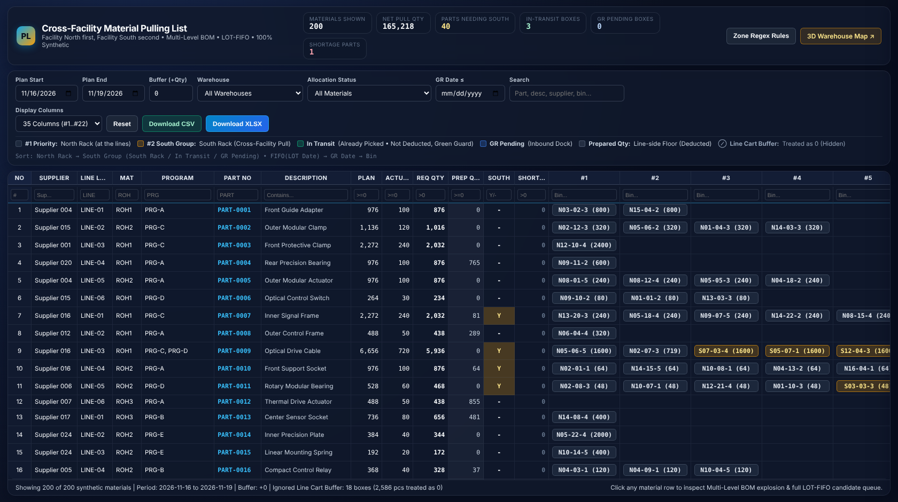
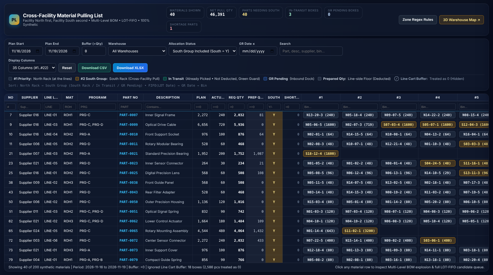
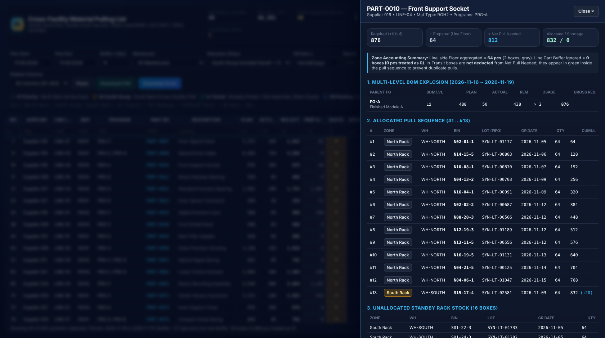

# Cross-Facility Material Pulling List (Demo)

[](https://miaou360.github.io/sequencing-pulling-list/demo/index.html)
[](https://miaou360.github.io/3d-warehouse-visualizer/)
[](LICENSE)
[](https://github.com/Miaou360/sequencing-pulling-list/actions/workflows/tests.yml)

An interactive material pulling planner for a two-facility plant (**Facility North** at the assembly lines, **Facility South** as the second building). It explodes multi-level Bills of Materials (BOM) against remaining production schedules and sequences box-by-box rack replenishment in strict **LOT-FIFO &rarr; Goods Receipt Date &rarr; Bin** order — **playable directly in your browser with zero installation**.

- **Live Pulling List Demo**: https://miaou360.github.io/sequencing-pulling-list/demo/index.html &bull; [Repository](https://github.com/Miaou360/sequencing-pulling-list)
- **Same plant in 3D — 3D Warehouse Visualizer**: [Repository](https://github.com/Miaou360/3d-warehouse-visualizer) &bull; [Live 3D Demo](https://miaou360.github.io/3d-warehouse-visualizer/)

> **One plant, two views.** The 3D Warehouse Visualizer shows *where* every pallet sits in Facility North and Facility South. This project decides *which of those pallets to pull, and in what order*, to feed the lines. Both demos read the same data: every bin on the pulling list (for example `N03-02-3` = North, rack 03, bay 02, level 3) is a pallet you can find in the 3D racks.

> **100% Synthetic Data**: The plant, parts, suppliers, BOM, forecast and pallets are the synthetic demo data of the 3D Warehouse Visualizer, converted by `tools/build_from_warehouse.py` (fixed seed, same output on every run). No real facility layout or operational record is included.

[](https://miaou360.github.io/sequencing-pulling-list/demo/index.html)

---

## Core Operational Logic

A plant that stores material in **Facility North** (next to the assembly lines) and **Facility South** (the second building) has two recurring replenishment problems: (1) pallets are requested from South while North still holds stock, which adds a transfer nobody needed, and (2) a second pull order is issued for pallets that were already picked in South and are on their way.

This planner resolves both through a five-step deterministic pipeline:

1. **Remaining Production Schedule (`Plan - Actual`)**
   - Over any user-selected planning window (`Start Date` ~ `End Date`), remaining finished-goods build demand is `max(0, Plan Qty - Actual Qty)` per finished product.
2. **Multi-Level BOM Explosion + Safety Buffer**
   - Finished-goods remaining demand is recursively exploded across sub-assemblies and purchased materials (`ROH1`, `ROH2`, `ROH3`), rolled up across shared common parts, plus an optional top-bar **`Buffer (+Qty)`**.
3. **Zone Classification via Configurable Regex (`demo/config/zone_rules.json`)**
   - **Line Cart Buffer (`LCB-*`, `BUF-*`)**: Point-of-use feeder carts that must remain full as a safety buffer &rarr; **treated as `0` and hidden everywhere**.
   - **Line-side Floor (`LSF-*`)**: Already staged on the assembly floor &rarr; summed into **`Prepared Qty`** and excluded from rack pull slots.
   - **North Rack (`WH-NORTH`, `N01-01-1`..)**: Priority 1 rack stock next to the lines (neutral slate cell).
   - **South Group (Priority 2 — allocated only after the North racks)**:
     - **South Rack (`WH-SOUTH`, `S01-01-1`..)** — **Yellow**: needs a cross-facility transfer from South to North.
     - **In Transit (`WH-NORTH` with an `S..` bin)** — **Green**: pallets already picked from a South rack; the system warehouse is already North while the bin still shows the South location. **Not deducted from `Net Pull Needed`**; kept in allocation order and highlighted green so the pallet is not requested twice.
     - **GR Pending (`WH-RCV`, `N-STG-..` / `S-STG-..`)** — **Blue**: received on the dock staging lanes, waiting for put-away.
   - **Quality Hold (`N-QH-..` / `S-QH-..`)**: shown for reference, never allocated.
4. **Net Pull Requirement & Whole-Box Allocation (`#1 .. #N`)**
   - `Net Pull Needed = max(0, Required Qty - Prepared Qty)`
   - Candidate boxes are ranked by:
     1. **Facility Priority**: `North Rack (1)` &rarr; `South Group (2: South Rack / In Transit / GR Pending)`
     2. **FIFO Key**: `LOT Date` ascending (oldest manufacturing/batch lot first)
     3. **Aging Tie-Breaker**: `GR Date` ascending (long-term stock rotation)
     4. **Coordinate Tie-Breaker**: `Bin` ascending
   - Whole boxes are allocated horizontally into columns **`#1, #2, ..., #N`** until cumulative allocated quantity meets or exceeds `Net Pull Needed`. Any unmet balance is flagged in **`Shortage`**.

[](https://miaou360.github.io/sequencing-pulling-list/demo/index.html)

[](https://miaou360.github.io/sequencing-pulling-list/demo/index.html)

---

## Interactive Features

- **Horizontal Allocation Matrix (`1 Row = 1 Material`)**: Displays `No`, `Supplier`, `Line Loc`, `Mat Type`, `Program`, `Part No`, `Description`, `Plan Qty`, `Actual Qty`, `Required Qty`, `Prepared Qty`, `South` flag (yellow highlight), `Shortage` (rose highlight), and dynamic `#1..#N` bin-quantity slots.
- **Per-Column Filter Expressions**: Supports case-insensitive substring matching (`PART-0002`, `S07`, `Y`) and numeric operators (`>0`, `>=300`, `<=100`, `=0`) on every column, plus column-count presets (`20 Columns`, `35 Columns`, `50 Columns`, `All Columns`).
- **Slide-Over Part Breakdown Drawer**: Click any row to inspect the multi-level parent BOM roll-up, `Required - Prepared = Net Pull` equation cards, allocated pull slots with whole-box rounding (`+Over`), unallocated standby rack stock, and ignored `Line Cart Buffer` counts.
- **Zero-Dependency CSV & Styled XLSX Export**: Downloads UTF-8 CSV or native OpenXML `.xlsx` workbooks with yellow (`South Rack`), green (`In Transit`), blue (`GR Pending`), and rose (`Shortage`) cell fills generated entirely in browser JavaScript.

---

## ERP / MES Adapter Integration Guide

In a production environment, replace `demo/data/synthetic_bundle.js` with live adapters feeding three normalized inputs:

1. **MES Schedule & BOM Adapter**: Maps work-order schedules (`plan_qty`, `actual_qty`) and multi-level BOM edges (`parent_id`, `component_id`, `qty_per`).
2. **ERP / WMS Inventory Snapshot (`backend/example_query.sql`)**: Maps standard ERP stock fields (`MATNR` &rarr; `part_no`, `LGORT` &rarr; `location`, `LABST` &rarr; `qty`, `CHARG` &rarr; `lot`, `GRDAT` &rarr; `gr_date`) from a generic `inventory_snapshot` view.
3. **Configurable Zone Regex (`demo/config/zone_rules.json`)**: Adapts warehouse codes, bin naming conventions, and sort keys via JSON regular expressions without touching `demo/engine.js`.

---

## Repository Structure

```text
.
├── index.html                    # Root redirect to demo/index.html for GitHub Pages
├── demo/
│   ├── index.html                # Main Pulling List web application
│   ├── style.css                 # Dark glassmorphic UI stylesheet
│   ├── engine.js                 # Multi-level BOM explosion & LOT-FIFO allocation engine
│   ├── app.js                    # Grid controller, column filters, drawer, CSV & XLSX exporters
│   ├── config/
│   │   └── zone_rules.json       # Configurable regex zone classification & sort priority rules
│   └── data/
│       ├── synthetic_bundle.js   # Dataset built from the 3D Warehouse Visualizer plant (static hosting)
│       └── synthetic_dataset.json
├── tools/
│   └── build_from_warehouse.py   # Converts the 3D Warehouse Visualizer data into this dataset (stdlib only)
├── tests/
│   └── engine.test.js            # Allocation rules: North first, FIFO, in transit, shortage
├── backend/
│   ├── server.py                 # Optional FastAPI + in-memory SQLite reference server
│   ├── example_query.sql         # Generic SQL zone & FIFO query on `inventory_snapshot`
│   └── requirements.txt
├── docs/
│   └── screenshots/              # Clean screenshots captured from synthetic demo data
└── LICENSE                       # MIT License
```

## Quick Start (Local)

### Option 1 — Zero-Install Static Demo (Recommended)

```bash
python -m http.server 8081 --directory demo
```

Then open `http://localhost:8081/index.html` in your browser.

### Option 2 — Rebuild the Dataset from the 3D Warehouse Visualizer

```bash
python tools/build_from_warehouse.py                                              # published 3D demo data
python tools/build_from_warehouse.py --source ../3d-warehouse-visualizer/demo/data  # local clone
```

### Run the Engine Tests

```bash
node --test tests/engine.test.js
```

### Option 3 — Run Optional FastAPI + SQLite Reference Backend

```bash
pip install -r backend/requirements.txt
uvicorn backend.server:app --reload --port 8001
```

Then visit `http://localhost:8001/demo/index.html` (API endpoints: `/api/health`, `/api/zone-rules`, `/api/candidates?part_no=PART-0002`).

## License

Released under the [MIT License](LICENSE). Zero third-party runtime libraries are bundled in `demo/`.

